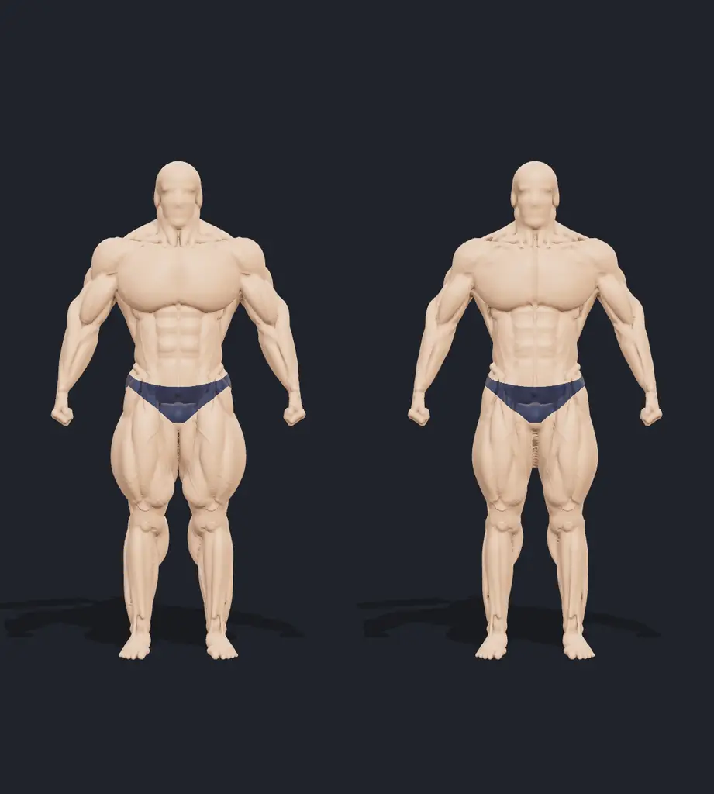

# Bodyhack Infinity

Two modules in one app: the **Appearance Explorer** (below) and the **Posing Tutor** (in
progress). Open a module with the switch at the top, or with `?module=explorer` or
`?module=posing` in the URL.

An interactive 3D playground for the words bodybuilders use to describe how muscles look —
*full, flat, spilled over, dry, crispy, separated, striated, vascular, mature* — and what is and
is not known about why a body looks that way.

It is an **educational illustration, not a physiological simulation**. The same procedural
figure, pose, camera and neutral light are used for every term; stage light, tan and oil are
separate controls so they can never secretly explain a difference attributed to muscle.



## Run it

Requirements: Node 22.18+, which runs the TypeScript setup script directly (Bun only if you want to rebuild
the model).

```sh
npm install
npm run mediapipe      # once: pose tracker WASM and model into public/mediapipe
npm run dev            # http://localhost:5173
```

Production build:

```sh
npm run build
npm run preview        # http://localhost:4173
```

The baked model files are already in `public/model` and `public/model-lite`. To regenerate them
(requires [Bun](https://bun.sh), multi-core recommended, ~3 minutes):

```sh
npm run model && npm run model:lite
```

Other scripts: `npm test` (content integrity, mapping and local API tests), `npm run typecheck`,
`npm run sources` (re-extract the verified source lists from `research/*.md`).

### Local API

`npm run dev` and `npm run preview` also serve a small JSON API from `server/` (a Vite plugin).
The browser never sees the keys.

| Endpoint | Needs | Does |
|---|---|---|
| `GET /api/health` | nothing | `{ ok, omp, jev }`: whether `omp` is on `PATH` and a jev key is set |
| `POST /api/intent` | `TYPESAFE_API_KEY` | picks a voice command: `{ heard, options }` → `{ choice, confidence, probabilities }` |
| `POST /api/coach` | `omp` on `PATH`, logged in | coach debrief of a snapshot via `omp -p`: `{ pose, summary, imageDataUrl?, model? }` → `{ cues, note, model, ms }` |

The server reads `TYPESAFE_API_KEY` from the environment, else from `.env.local` in the project
root, else `~/git/crispy/.env.local`, else `~/.config/bodyhack-infinity/env`. Set
`BODYHACK_COACH_MODEL` to change the coach model (default `anthropic/claude-sonnet-5`).

### Pose tracking assets and debug page

`npm run mediapipe` copies the MediaPipe WASM from the pinned `@mediapipe/tasks-vision` package and downloads
the pose model, checked by SHA-256, into `public/mediapipe/` (34 MB, git-ignored). Run it again after upgrading
the package. The tracker loads nothing from a CDN, but MediaPipe itself posts usage metrics to
`odml.pa.googleapis.com` about once a minute (see the privacy notice in the package README).

`/posing-debug.html` runs the live loop on the camera or on a dropped image or video file: landmarks over the
frame, the metrics, the called pose's score and faults, the cue scheduler's events and the spoken cues. Add
`?pose=<id>` to call another pose (default `frontDoubleBiceps`).

## What you can do

- **Explore** — a vocabulary deck of 25 term cards in five color-coded groups (volume,
  leanness, detail, structure, stage). Most cards move the model (four are explanation-only).
  Each card lists numbered "Look for" cues (click one to fly the camera there and make the
  region glow), a *What changed* readout with from/to bars, usage and evidence badges, a
  deeper explanation and its sources. Cards you open are counted in the "explored" tracker.
- **Stack terms** — switch on *Stack terms* (or Shift-click cards) to combine up to four cards,
  for example Peeled + Shredded or Full + Dry. Each card only overrides the controls it is
  actually about. When two cards pull the same control in opposite directions (e.g. Soft /
  off-season vs Shredded), the tray shows a *Clash!* note and the model splits the difference.
- **Look meter** — a HUD with the eight illustrative control values as bars (twin A/B bars in
  Versus; hidden in Challenge until you answer). *Tune it yourself* opens the sandbox sliders.
  These are artistic values, not measurements; soft tissue and smoothing deliberately hide the
  other detail.
- **Skin & tan** — a skin-tone slider (light to deep) and a spray-tan slider (None → Light →
  Medium → Show → Pro dark), plus oil/sheen and *Natural* / *Show day* quick settings. The tan
  darkens light skin more than deep skin, and a darker tan makes grooves read deeper. It never
  changes the body and always applies to both sides of a comparison.
- **Versus** — ten matched face-offs validated against the research (full vs flat at the same
  leanness; full & sharp vs "spilled"; small & lean vs bigger & softer; separation vs
  striations; mature/grainy vs smoother at the same size and fat; dry vs watery at the same
  volume; pumped vs unpumped; vascular vs not; same body under neutral vs stage light;
  off-season vs stage-ready), or a custom match. One camera drives both halves.
- **Challenge** — ten randomized pairs ("Which side looks flatter?") with points, a streak
  bonus, progress pips, a rank at the end and a saved best score. The reveal makes the relevant
  regions glow, explains the intended reading, and says when more than one description is fair
  (including a trick pair where only the light differs). The rank scores your eye for the
  vocabulary, not anyone's body.
- Orbit/zoom, front/¾/side/back views, region focus (shoulders, chest, arms, forearms, abs,
  upper back, lower back, glutes, quads, hamstrings, calves), reset, neutral vs stage light,
  HD/Lite mesh detail.
- Keyboard: `1`–`4` views, `R` reset, `L` light toggle; all controls are buttons/inputs with
  labels. Reduced motion follows the OS setting and can be toggled in the top bar (it also turns
  off the game animations). Without WebGL 2 the app shows pre-rendered comparisons and keeps all
  explanations.

## How the figure is rendered

The figure is a signed distance field built from 48 muscle definitions per side (116 swept-ellipse
fiber bundles from origin to insertion), bony landmarks, deep fill, 18 superficial vein paths per side
and regional fat deposits. A Bun pipeline meshes the lean base state and bakes nine morph
targets by re-finding each target surface along every vertex normal:

| Control | What it changes on the model |
|---|---|
| Fullness | Belly radius and depth along each bundle's profile; tendons and skeleton fixed |
| Size | Muscle cross-sections overall (more at bellies) |
| Soft tissue (fat) | Low-pass of the muscle relief + skin/fat layer + regional deposits |
| Smoothness | Even low-pass and thin layer, no regional thickening |
| Separation | Grooves cut along the real borders between modeled muscles |
| Detail | Grooves between heads of one muscle + shader grain |
| Vascularity | Vein tubes on authored anatomical paths, projected onto the skin |
| Striations | Shader ridges along each muscle's fiber direction, masked to bellies |

Per-target ambient occlusion comes from the SDF, so grooves read in neutral light. Full
details: [`docs/modeling.md`](docs/modeling.md).

## Research and sources

Four research reports in `research/` cover fullness/water/pump/peak week, conditioning terms
and judging criteria, separation/striations/vascularity (with an anatomy appendix for muscle
attachments, fiber directions and superficial veins), and maturity/density/shape/insertions/
symmetry. Each separates the visual impression, the community's claimed cause, and what
academic evidence supports. Physiology claims cite academic sources; usage claims cite
rulebooks, judges, coaches and publications; forums are used only to show usage. No
dehydration, diuretic, drug or contest-prep protocols are included.

The reports list 342 sources that the research agents fetched and checked; the app cites 172
of them (`src/content/sources.generated.json` is extracted from the reports, so every link in
the app is one of those entries). A final automated check returned content for 168 of the 172
cited URLs; the other four (two DOI redirects and two Merriam-Webster pages) block automated
requests and open normally in a browser.

Key findings that shaped the app:

- Separation and striations are different concepts (rulebooks treat striations as a level
  beyond separation); both need a thin fat layer; what the visible lines are is unproven.
- Carbohydrate loading changes muscle thickness by about 2–5%; the link to what judges see is
  unproven, so the model labels its fullness change as exaggerated for teaching.
- "Spilled over" and "dry/watery" describe surface sharpness; the water-under-the-skin
  explanation has no direct evidence, and softness from fat looks the same, so the model uses
  the same surface controls and never draws a water layer.
- "Vascular means dry" is not supported.
- "Maturity", "density", "hardness" and "grain" are overlapping slang without a demonstrated
  tissue change beyond more muscle and less fat; the model changes only surface detail at
  fixed size and fat, and has no age slider.
- The "Christmas tree" is erector and lat borders seen through thin fat.

## Asset attribution

- **3D model**: procedural, written for this project (`scripts/model/`). No third-party mesh,
  texture or image is used. Candidate assets that were evaluated and rejected (MakeHuman,
  Écorché, BodyParts3D, Z-Anatomy, NIH 3D, museum scans, Sketchfab) are documented with their
  licenses in `research/assets.md`.
- **Visual references**: the research reports link openly licensed Wikimedia Commons photos with
  author and license recorded; none is copied into the app.
- **Libraries**: three.js (MIT), React (MIT), Vite (MIT), Vitest (MIT), TypeScript (Apache-2.0).
- **Fonts** (bundled through Fontsource): Bebas Neue © The Bebas Neue Project Authors (Dharma
  Type) and Outfit © The Outfit Project Authors, both SIL Open Font License 1.1.

## Limitations (honest account)

- **Illustrative, not measured.** Controls are artistic. The figure's proportions are a plausible
  heavyweight physique, not a scan of a real person. Fat distribution is illustrative.
- **One pose.** Only a relaxed front stance. Real striations and peaks show mostly when flexed;
  the model shows them unflexed. "Pumped" is applied to the whole body for simplicity.
- **Head.** Deliberately simplified to a mannequin head after realistic faces looked uncanny.
- **Mirror symmetric.** The tool cannot show asymmetry; symmetry, insertions and V-taper are
  explanation-only terms because showing them honestly would need a different person.
- **Not modeled**: "diced" crossing patterns, flexing, individual vein maps. Skin tone and spray
  tan are a single albedo color (no subsurface scattering, freckles or uneven tan); oil is a
  clearcoat layer.
- **Artifacts**: at high softness, small slivers can appear in tight creases (armpit, crotch,
  gluteal fold, inside the elbow) where the soft-tissue morph fills a gap. Striations can show
  slight moiré where many lines converge near a tendon.
- **Performance**: frame time scales with triangle count. On the only GPU available for testing
  (a remote Intel UHD 620 driven by headless Chromium) the detailed mesh took ~280 ms per frame
  and the lite mesh ~140 ms; the app switches to the lite mesh automatically when the first
  frame is slow. Desktop GPUs were not available for testing.

## Project layout

```
src/                 React app, Three.js viewer, shader, content
  content/           terms, comparisons, quiz, presets, generated sources
  three/             Viewer (A/B scissor rendering), skin shader, model loader, control mapping
  posing/            pose domain, tracker, smoothing, cue scheduler, speech, debug page
scripts/model/       SDF anatomy, field, mesher, morph baking (Bun)
scripts/content/     source extraction from research reports
research/            research reports, asset survey, region screenshots from the modeling agents
docs/                modeling notes and verification screenshots
public/model*        baked models; public/fallback: no-WebGL images
public/mediapipe/    MediaPipe WASM and pose model (npm run mediapipe, git-ignored)
shot.html            render harness used for verification
posing-debug.html    tracking and cue debug page
```
