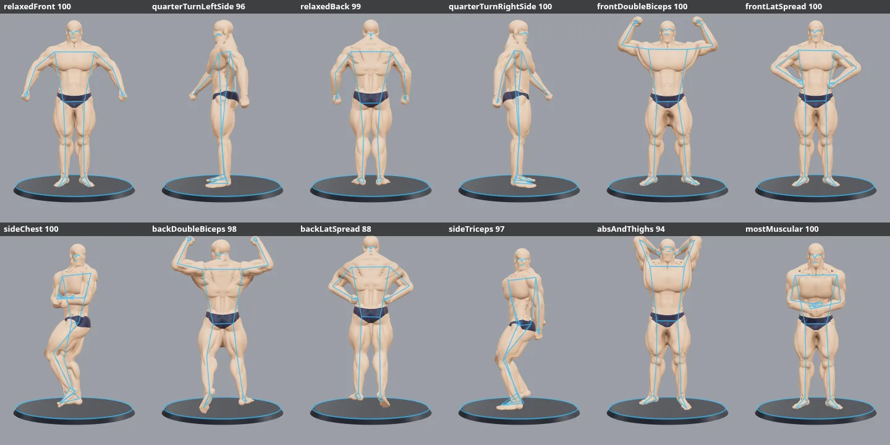

# Tracking gate report

Generated by `npm run gate` (`scripts/gate.ts`, harness `gate.html` and `src/posing/gate/`). Do not edit by hand.

Run 2026-10-10T20:26:02.435Z. Backend: GPU: `ANGLE (AMD, Vulkan 1.4.335 (AMD Radeon RX 7900 XTX (RADV NAVI31) (0x0000744C)), radv)`; MediaPipe delegate GPU. Frames 1280x720, 10 per pose, median score. Calibration from the relaxed-front render: yes.

**Result: PASS**

## Pass criteria

1. Own pose: every pose scored from the front or back (RF, RB, FDB, FLS, BDB, BLS, AT, MM) scores at least 85 for itself.
2. Clearly different poses score below 60 ("–", no score, counts as below). Two poses are clearly different when they share no facing, or when one has the arms overhead (FDB, BDB, AT) and the other has them down.
3. Pairs with the same facing and arm class are 2D look-alikes. Their cross scores are listed below and do not fail the gate; for example front lat spread and most muscular with the hands on the hips look the same to a front camera.
4. Side poses (QL, QR, SC, ST) are informative only: a front camera sees side poses poorly.
5. Each fault render gives its expected cue as the top correction and scores below 85.

## How a case runs

The figure is rendered with the app's Viewer from the judges' view (front camera, full body, plain wall) and each canvas frame goes through the live pipeline: `createTracker` (MediaPipe Pose Landmarker, VIDEO mode), `LandmarkSmoother`, `measure` (calibrated on the relaxed-front render), `classifyFacing` and `scoreCall` for all 12 calls.

Each case starts with empty frames, so MediaPipe loses the previous case, then shows the relaxed stance of the call's facing, as between calls at prejudging, then the pose. Without the empty frames, VIDEO mode carried the previous case's tracking region into the next case, and a score changed when an earlier pose changed (abs and thighs moved from 88 to 84.8 after a side triceps edit). Without the relaxed lead-in, a fresh detection of abs and thighs misplaced the trunk (shoulders at the head, hips at the knees) and scored 35.

## Changes since the baseline

1. **baseline** (6 failures): Before any change: the committed figure poses, scorer and spec (commit d0a99b9), with the current harness and fault set.
2. **falloff** (3 failures): Scorer change only: score.ts falls to 0 at half a band width instead of one (option (a), step 1). The worst-check cap of step 2 was not needed: the 30° elbow drop fell from 88 to 66. Reference photo wnbf_bls falls from 94.9 to 91.7; accepted.
3. **hiddenWrists** (2 failures): Plus spec.ts: the hidden-wrist bands (abs and thighs, back lat spread, side triceps rear hand) end at MIN_VISIBILITY (0.5), the cut the app uses for hidden everywhere. The figure's hidden wrists read 0.44 to 0.57; the photos read 0.00 to 0.26.
4. **final** (0 failures): this run.

## Own-pose scores

| pose | baseline | falloff | hiddenWrists | final | detected | facing | top cue (final) | verdict |
| --- | --- | --- | --- | --- | --- | --- | --- | --- |
| Relaxed front | 100 | 100 | 100 | **100** | 10/10 | front | – | pass |
| Quarter turn, left side | 98 | 96 | 96 | **96** | 10/10 | leftSide | Let your arms hang naturally. | informative |
| Relaxed back | 100 | 99 | 99 | **99** | 10/10 | back | Square your shoulders to the back wall. | pass |
| Quarter turn, right side | 100 | 100 | 100 | **100** | 10/10 | rightSide | – | informative |
| Front double biceps | 100 | 100 | 100 | **100** | 10/10 | front | – | pass |
| Front lat spread | 99 | 97 | 97 | **100** | 10/10 | front | – | pass |
| Side chest, left side | 97 | 92 | 92 | **100** | 10/10 | leftSide | – | informative |
| Back double biceps | 100 | 98 | 98 | **98** | 10/10 | back | Drop your shoulders, spread your back. | pass |
| Back lat spread | 88 | 84 | 85 | **88** | 10/10 | back | Put your hands on your waist. | pass |
| Side triceps, left side | 94 | 85 | 95 | **93** | 10/10 | leftSide | Front foot flat, back heel up. | informative |
| Abdominals and thighs | 84 | 83 | 91 | **94** | 10/10 | front | Put both hands behind your head. | pass |
| Most muscular, crab | 100 | 100 | 100 | **100** | 10/10 | front | – | pass |

## Final matrix

Rows are the rendered pose, columns the called pose. Bold is the own score; ✗ marks a failing cell.

| rendered \ called | facing | RF | QL | RB | QR | FDB | FLS | SC | BDB | BLS | ST | AT | MM |
| --- | --- | --- | --- | --- | --- | --- | --- | --- | --- | --- | --- | --- | --- |
| RF | front | **100** | – | – | – | 22 | 60 | – | – | – | – | 33 | 64 |
| QL (side) | leftSide | – | **96** | – | – | – | – | 41 | – | – | 56 | – | – |
| RB | back | – | – | **99** | – | – | – | – | 15 | 66 | – | – | – |
| QR (side) | rightSide | – | – | – | **100** | – | – | 34 | – | – | 68 | – | – |
| FDB | front | 37 | – | – | – | **100** | 51 | – | – | – | – | 35 | 34 |
| FLS | front | 68 | – | – | – | 38 | **100** | – | – | – | – | 33 | 88 |
| SC (side) | leftSide | – | 56 | – | – | – | – | **100** | – | – | 53 | – | – |
| BDB | back | – | – | 43 | – | – | – | – | **98** | 43 | – | – | – |
| BLS | back | – | – | 70 | – | – | – | – | 28 | **88** | – | – | – |
| ST (side) | leftSide | – | 79 | – | – | – | – | 57 | – | – | **93** | – | – |
| AT | front | 39 | – | – | – | 31 | 30 | – | – | – | – | **94** | 39 |
| MM | front | 42 | – | – | – | 27 | 50 | – | – | – | – | 39 | **100** |

## 2D look-alikes (not failures)

| rendered | called | score |
| --- | --- | --- |
| RF | MM | 64 |
| RB | BLS | 66 |
| FLS | RF | 68 |
| FLS | MM | 88 |
| BLS | RB | 70 |

## Fault renders

Score and top cue of the broken pose's own call.

| fault | expected top cue | baseline | falloff | hiddenWrists | final | verdict |
| --- | --- | --- | --- | --- | --- | --- |
| Front double biceps, both elbows dropped 30° | "Raise your elbows to shoulder height." | 88, "Raise your elbows to shoulder height." | 66, "Raise your elbows to shoulder height." | 66, "Raise your elbows to shoulder height." | **66**, "Raise your elbows to shoulder height." | pass |
| Front double biceps, upper arms turned in 65° so the forearms tip toward the camera and the fists sit low | "Bring your fists up to your ears." | 83, "Ease your fists away from your head." | 70, "Bring your fists up to your ears." | 70, "Bring your fists up to your ears." | **70**, "Bring your fists up to your ears." | pass |
| Front lat spread, both elbows swung 50° forward and in, hands kept on the waist | "Spread your lats wider." | 92, "Spread your lats wider." | 83, "Spread your lats wider." | 83, "Spread your lats wider." | **82**, "Spread your lats wider." | pass |
| Back double biceps, left arm dropped 35° | "Lift your elbows above your shoulders." | 90, "Lift your elbows above your shoulders." | 79, "Lift your elbows above your shoulders." | 79, "Lift your elbows above your shoulders." | **79**, "Lift your elbows above your shoulders." | pass |

## Reference photos

Own-pose score of the 26 reference photos (`src/posing/fixtures`) under the scoring of each run.

| photo | pose | baseline | falloff | hiddenWrists | final |
| --- | --- | --- | --- | --- | --- |
| ifbb_bb_front | RF | 100.0 | 100.0 | 100.0 | 100.0 |
| ifbb_cp_front | RF | 100.0 | 100.0 | 100.0 | 100.0 |
| ifbb_cp_qt_leftside | QL | 100.0 | 100.0 | 100.0 | 100.0 |
| ifbb_cp_qt_rightside | QR | 100.0 | 100.0 | 100.0 | 100.0 |
| ifbb_cp_back | RB | 100.0 | 100.0 | 100.0 | 100.0 |
| ifbb_bb_fdb | FDB | 100.0 | 100.0 | 100.0 | 100.0 |
| ifbb_cp_fdb | FDB | 100.0 | 100.0 | 100.0 | 100.0 |
| wnbf_fdb | FDB | 100.0 | 100.0 | 100.0 | 100.0 |
| ifbb_bb_fls | FLS | 100.0 | 100.0 | 100.0 | 100.0 |
| wnbf_fls | FLS | 100.0 | 100.0 | 100.0 | 100.0 |
| ifbb_bb_sc | SC | 100.0 | 100.0 | 100.0 | 100.0 |
| ifbb_cp_sc | SC | 100.0 | 100.0 | 100.0 | 100.0 |
| wnbf_sc | SC | 100.0 | 100.0 | 100.0 | 100.0 |
| ifbb_bb_bdb | BDB | 100.0 | 100.0 | 100.0 | 100.0 |
| ifbb_cp_bdb | BDB | 100.0 | 100.0 | 100.0 | 100.0 |
| wnbf_bdb | BDB | 100.0 | 100.0 | 100.0 | 100.0 |
| ifbb_bb_bls | BLS | 100.0 | 100.0 | 100.0 | 100.0 |
| wnbf_bls | BLS | 94.9 | 91.7 | 91.7 | 91.7 |
| ifbb_bb_st | ST | 100.0 | 100.0 | 100.0 | 100.0 |
| ifbb_cp_st | ST | 100.0 | 100.0 | 100.0 | 100.0 |
| wnbf_st | ST | 99.9 | 99.7 | 99.7 | 99.7 |
| ifbb_bb_at | AT | – | – | – | – |
| ifbb_cp_at | AT | 100.0 | 100.0 | 100.0 | 100.0 |
| wnbf_at | AT | 100.0 | 100.0 | 100.0 | 100.0 |
| wnbf_mm_hips | MM | 100.0 | 100.0 | 100.0 | 100.0 |
| wnbf_mm_crab | MM | 100.0 | 100.0 | 100.0 | 100.0 |

Below 95 in this run: wnbf_bls 91.7. No score: ifbb_bb_at.

## Contact sheet

The frames that went into MediaPipe, cropped, with the smoothed landmarks drawn on top.

## Matrix: baseline

Run 2026-10-10T20:23:43.965Z. Backend: GPU: `ANGLE (AMD, Vulkan 1.4.335 (AMD Radeon RX 7900 XTX (RADV NAVI31) (0x0000744C)), radv)`; MediaPipe delegate GPU. Before any change: the committed figure poses, scorer and spec (commit d0a99b9), with the current harness and fault set.

| rendered \ called | facing | RF | QL | RB | QR | FDB | FLS | SC | BDB | BLS | ST | AT | MM |
| --- | --- | --- | --- | --- | --- | --- | --- | --- | --- | --- | --- | --- | --- |
| RF | front | **100** | – | – | – | 29 | 65 | – | – | – | – | 33 | 71 |
| QL (side) | leftSide | – | **98** | – | – | – | – | 47 | – | – | 65 | – | – |
| RB | back | – | – | **100** | – | – | – | – | 18 | 66 | – | – | – |
| QR (side) | rightSide | – | – | – | **100** | – | – | 44 | – | – | 68 | – | – |
| FDB | front | 41 | – | – | – | **100** | 51 | – | – | – | – | 56 | 34 |
| FLS | front | 68 | – | – | – | 41 | **99** | – | – | – | – | 33 | 80 |
| SC (side) | leftSide | – | 65 | – | – | – | – | **97** | – | – | 50 | – | – |
| BDB | back | – | – | 47 | – | – | – | – | **100** | 45 | – | – | – |
| BLS | back | – | – | 69 | – | – | – | – | 32 | **88** | – | – | – |
| ST (side) | leftSide | – | 86 | – | – | – | – | 69 | – | – | **94** | – | – |
| AT | front | 36 | – | – | – | 43 | 41 | – | – | – | – | **84** ✗ | 65 ✗ |
| MM | front | 54 | – | – | – | 31 | 61 | – | – | – | – | 33 | **100** |

## Matrix: falloff

Run 2026-10-10T20:23:48.036Z. Backend: GPU: `ANGLE (AMD, Vulkan 1.4.335 (AMD Radeon RX 7900 XTX (RADV NAVI31) (0x0000744C)), radv)`; MediaPipe delegate GPU. Scorer change only: score.ts falls to 0 at half a band width instead of one (option (a), step 1). The worst-check cap of step 2 was not needed: the 30° elbow drop fell from 88 to 66. Reference photo wnbf_bls falls from 94.9 to 91.7; accepted.

| rendered \ called | facing | RF | QL | RB | QR | FDB | FLS | SC | BDB | BLS | ST | AT | MM |
| --- | --- | --- | --- | --- | --- | --- | --- | --- | --- | --- | --- | --- | --- |
| RF | front | **100** | – | – | – | 22 | 60 | – | – | – | – | 33 | 64 |
| QL (side) | leftSide | – | **96** | – | – | – | – | 41 | – | – | 56 | – | – |
| RB | back | – | – | **99** | – | – | – | – | 15 | 66 | – | – | – |
| QR (side) | rightSide | – | – | – | **100** | – | – | 34 | – | – | 63 | – | – |
| FDB | front | 37 | – | – | – | **100** | 51 | – | – | – | – | 35 | 34 |
| FLS | front | 68 | – | – | – | 37 | **97** | – | – | – | – | 33 | 62 |
| SC (side) | leftSide | – | 61 | – | – | – | – | **92** | – | – | 43 | – | – |
| BDB | back | – | – | 43 | – | – | – | – | **98** | 43 | – | – | – |
| BLS | back | – | – | 65 | – | – | – | – | 26 | **84** ✗ | – | – | – |
| ST (side) | leftSide | – | 81 | – | – | – | – | 63 | – | – | **85** | – | – |
| AT | front | 29 | – | – | – | 39 | 36 | – | – | – | – | **83** ✗ | 65 ✗ |
| MM | front | 42 | – | – | – | 27 | 50 | – | – | – | – | 31 | **100** |

## Matrix: hiddenWrists

Run 2026-10-10T20:23:52.029Z. Backend: GPU: `ANGLE (AMD, Vulkan 1.4.335 (AMD Radeon RX 7900 XTX (RADV NAVI31) (0x0000744C)), radv)`; MediaPipe delegate GPU. Plus spec.ts: the hidden-wrist bands (abs and thighs, back lat spread, side triceps rear hand) end at MIN_VISIBILITY (0.5), the cut the app uses for hidden everywhere. The figure's hidden wrists read 0.44 to 0.57; the photos read 0.00 to 0.26.

| rendered \ called | facing | RF | QL | RB | QR | FDB | FLS | SC | BDB | BLS | ST | AT | MM |
| --- | --- | --- | --- | --- | --- | --- | --- | --- | --- | --- | --- | --- | --- |
| RF | front | **100** | – | – | – | 22 | 60 | – | – | – | – | 33 | 64 |
| QL (side) | leftSide | – | **96** | – | – | – | – | 41 | – | – | 56 | – | – |
| RB | back | – | – | **99** | – | – | – | – | 15 | 66 | – | – | – |
| QR (side) | rightSide | – | – | – | **100** | – | – | 34 | – | – | 68 | – | – |
| FDB | front | 37 | – | – | – | **100** | 51 | – | – | – | – | 35 | 34 |
| FLS | front | 68 | – | – | – | 37 | **97** | – | – | – | – | 33 | 62 |
| SC (side) | leftSide | – | 61 | – | – | – | – | **92** | – | – | 45 | – | – |
| BDB | back | – | – | 43 | – | – | – | – | **98** | 44 | – | – | – |
| BLS | back | – | – | 65 | – | – | – | – | 26 | **85** ✗ | – | – | – |
| ST (side) | leftSide | – | 81 | – | – | – | – | 63 | – | – | **95** | – | – |
| AT | front | 29 | – | – | – | 39 | 36 | – | – | – | – | **91** | 65 ✗ |
| MM | front | 42 | – | – | – | 27 | 50 | – | – | – | – | 33 | **100** |
